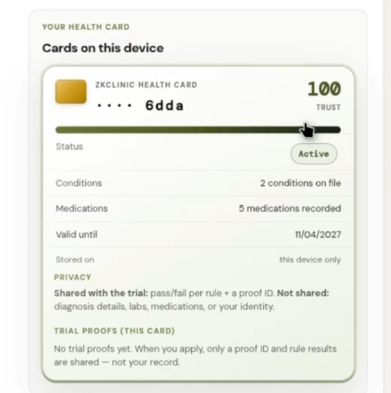
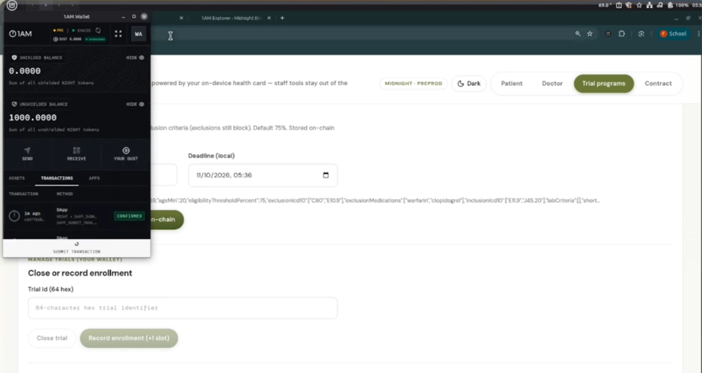
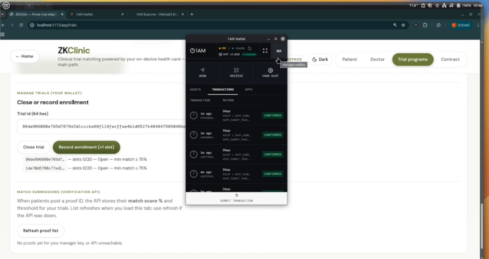
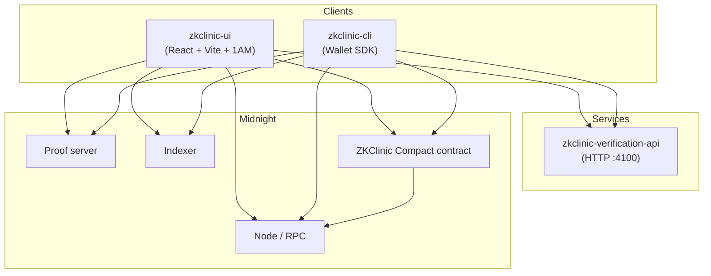
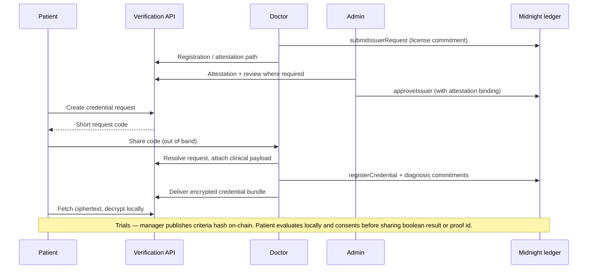

# ZKClinic

> **Prove you qualify for a clinical trial — without handing over your medical record.**
> ZKClinic is a ZK-native clinical trial recruitment protocol built on [Midnight Network](https://midnight.network).

**Demo video:** [https://youtu.be/RYE_c_51CQw](https://youtu.be/RYE_c_51CQw)

> **Heads-up on the hosted backend.** The demo Verification API runs on a free hosting tier (Render) with limited resources. After a period of idle time it goes to sleep, and under load it can be slow or temporarily unavailable — so the backend may not respond on the first requests (give it up to a minute to wake up). The app header shows a live **API status** pill (*online* / *waking up…*) so you can tell. For a fully reliable run, start the API locally (see [Quick start](#quick-start)).

---

## The problem it solves

ZKLinic is a ZK-native clinical trial recruitment protocol built on Midnight Network. It solves the single most expensive problem in medical research - 85% of clinical trials fail to recruit enough patients on time, not because eligible patients don't exist, but because finding them requires those patients to hand their entire medical record to a pharma company they've never met.

Here is exactly where Midnight sits in the architecture. A doctor signs a structured health credential for their patient - diagnosis codes, lab values, medication history - using their on-chain registered wallet. The credential lives on the patient's device. It never touches any server. When the patient applies for a trial, ZKLinic generates a ZK proof on their device that checks their credential against the trial's eligibility criteria. That proof - containing only boolean results per criterion, no clinical data - is posted to Midnight's public ledger. The trial recruiter queries the proof ID and sees exactly one thing: this person is eligible, criterion by criterion, verified by a licensed physician, proven by cryptography. They see nothing else.


What is verified on-chain: credential issuer validity, eligibility booleans, proof binding to a specific trial. What stays private: the patient's identity, their exact diagnosis, their lab values, their age, their medication history, every clinical detail that produced those booleans. The verifier is the clinical trial recruiter. What they need to see is a yes or no per criterion, backed by a doctor's signature and a ZK proof they can verify independently on the Midnight explorer. That is all they get. That is all they need.
ZKLinic is not a diagnostic app. It is not a medical records platform. It is the trust infrastructure that lets a patient prove they qualify for a trial without becoming a data source for the institution running it.

---

## How it looks

| | |
| --- | --- |
| **Health card** — the credential lives on the patient's device only. The card shows status, validity and exactly what is (pass/fail per rule + a proof ID) and is not (diagnosis, labs, medications, identity) shared with a trial. |  |
| **Trial manager + wallet** — a trial manager publishes eligibility criteria and submits the transaction from their [1AM](https://1am.xyz/) wallet on Midnight Preprod. |  |
| **On-chain confirmation** — every trial action (create, enroll, close) is a confirmed Midnight transaction; slots and status are enforced by the contract. |  |

---

## Challenges I ran into

- **Keeping clinical data off every server and still making it verifiable.** The credential is encrypted and stored only on the patient's device; the chain sees issuer validity, diagnosis *commitments* and eligibility booleans — never the underlying values. Designing which facts are public, which are committed, and which never leave the device shaped the whole contract.
- **Midnight tooling moving under our feet.** Wallet/SDK sync behaved differently across indexer API versions (v3 vs v4), dust sync needs a reachable local proof server (without it, sync can sit on `dust=false` until it times out), and Midnight's own hosted Preprod indexer/RPC has since been retired in favour of Blockfrost — so the CLI's Preprod config now reads `BLOCKFROST_PROJECT_ID`.
- **Running a ZK stack in the browser.** WASM ledger/runtime bundles, top-level `await`, Node polyfills (`Buffer`, `crypto`) and IndexedDB-backed private state all had to cooperate inside Vite and the [1AM](https://1am.xyz/) DApp Connector.
- **Trusting the issuer, not just the patient.** A proof is only meaningful if a *real* physician signed the credential, so doctors go through registration, attestation (including an India NMC registry lookup and certificate OCR) and admin approval before they can issue anything.
- **Making privacy feel simple.** Patients should never have to read a cryptography paper: the UI uses a health-card metaphor, an explicit "what is shared" disclosure step before any proof is created, and plain-language trial criteria (E11.9 → "Type 2 Diabetes").
- **Free-tier hosting.** The demo backend sleeps when idle and has limited resources, which is why the app now surfaces API status and why local setup is documented step by step.

---

## Technologies I used

| Layer | Stack |
| --- | --- |
| **Blockchain / ZK** | [Midnight Network](https://midnight.network), the **Compact** smart-contract language, Midnight JS SDK (`midnight-js-contracts`, indexer / proof / ZK-config providers), Midnight Wallet SDK (HD wallet, shielded / unshielded / dust), Midnight **proof server** (Docker) |
| **Wallet** | [1AM](https://1am.xyz/) browser wallet via `@midnight-ntwrk/dapp-connector-api` |
| **Frontend** | React 19, TypeScript, Vite (WASM + top-level-await plugins), React Router, Tailwind CSS, Framer Motion, styled-components, NeoPOP (`@cred/neopop-web`), Lucide icons, Tesseract.js (client-side OCR) |
| **Backend** | Node.js, Restify, JSON-file persistence; WHO **ICD-11** API and ICD-10 code sets; India **NMC** doctor-registry lookup; optional Google **Gemini** assistant for form autofill |
| **CLI** | Node.js + `tsx`, headless Midnight Wallet SDK, interactive role-based menus |
| **Quality** | Vitest (unit), Playwright (E2E, desktop + mobile), TypeScript strict mode |
| **Infra** | Docker (proof server), Render (API), Vercel (UI), Blockfrost (Preprod indexer/RPC) |

---

## How we built it

1. **Contract first.** A single Compact contract (`contract/src/zkclinic.compact`) holds the issuer registry, credential registry (with revocation and diagnosis commitments) and the trial lifecycle (`createTrial`, `recordEnrollment`, `closeTrial`). The compiled circuits and keys are committed so the app builds without the Compact compiler.
2. **Off-chain trust layer.** The Verification API handles what shouldn't live on-chain: doctor attestation and review, credential-request codes, encrypted credential delivery, trial metadata/validation, and proof-ID bookkeeping.
3. **Patient-first web app.** The UI keeps the credential on-device, evaluates eligibility locally against a trial's criteria, shows a boolean-only disclosure, and only then creates a proof ID. Doctor, admin and trial-manager tools live in separate tabs.
4. **A CLI for every role.** The headless CLI exercises the whole protocol (deploy, join, issue, enroll) without a browser wallet — handy for demos and CI-style walkthroughs.
5. **Test and polish.** Unit tests across all packages, Playwright smoke/mobile tests, and UX additions such as saved trials, a command palette and API status (see [UI features](#ui-features-no-contract-changes)).

The [system architecture](#system-architecture) and [end-to-end user flow](#user-flow-end-to-end) below show how the pieces connect.

---

## What we learned

- **Privacy is a product problem as much as a cryptography problem.** The hardest part wasn't producing a proof — it was making it obvious to a patient exactly what leaves their device.
- **Design the public/private split early.** Deciding what is a ledger value, a commitment, or device-only state determines every circuit and every screen.
- **Pin and verify the whole toolchain.** Proof-server, ledger, SDK and indexer versions must line up; being able to read sync progress and fail loudly saved a lot of time.
- **Off-chain services still need to be honest about being off-chain.** Free hosting sleeps, so the UI should say so instead of failing silently.
- **Boolean-only disclosure is enough.** Recruiters need "eligible, criterion by criterion, signed by a licensed doctor" — nothing more.

---

## What's next for ZKClinic

- Move the credential-request and proof-bookkeeping services to always-on hosting (or fully on-chain/peer-to-peer) so the demo no longer depends on a sleeping free-tier backend.
- Patient-controlled **reveal** and on-chain messaging so a trial manager can contact an eligible patient via proof ID without email or phone.
- Credential **recovery** flows (encrypted backup/restore across devices) and proof expiry reminders.
- More issuer types and registries beyond India NMC, plus richer lab-value and medication criteria.
- A security review, mainnet readiness, and pilots with real trial sponsors and clinics.

---

## Contents of this repository — technical reference

The sections below document the contracts, services, wallets and scripts in detail.

---

## UI features (no contract changes)

Quality-of-life additions that live entirely in `zkclinic-ui` — they don't touch the Compact contract, the API, or any proof logic:

- **Saved trials & deadline urgency** — star a trial in *Trial matching* to bookmark it on this device (localStorage only, never sent anywhere), filter with **Saved only**, and see a "Closes in 3d" badge plus a slots-filled progress bar on each trial card.
- **Command palette** — press `Ctrl/⌘ + K` anywhere to jump between Patient / Doctor / Trial programs / Contract / Docs, toggle dark mode, or copy the joined contract address.
- **API status pill** — the app header shows whether the Verification API is *online* or *waking up…* (free-tier hosting sleeps when idle).
- **Click-to-fill trial manager** — pick a trial from your list ("Use this trial") instead of pasting a 64-character id, with a slots progress bar and one-click **Copy ID**.
- **Copy buttons** — one-click copy for proof IDs and trial IDs.

---

## Contracts deployed

Use these 64-character hex registry addresses to **join** the same deployment from the CLI or the web UI (paste into “Connect contract” or press Enter when the CLI offers `ZKCLINIC_CONTRACT_ADDRESS`).


| Network                                                              | Contract address (hex, 64 chars)                                   |
| -------------------------------------------------------------------- | ------------------------------------------------------------------ |
| **Preview** (deployment 1)                                           | `86b8c4ed80a2d6c4bc45a1ac134607afb1d1499e2a864a2f0241a2e1537a507e` |
| **Preview** (deployment 2)                                           | `9ab8ce9cbe435786a5877d8f9c50faaa3d4c9ab8652b72417720b8422831e4e3` |
| **Pre-production (`preprod`)**                                       | `f4bf7e879850040a0521234ea05824943cd60d32b669d8cba142a823cb6e3aae` |


To use your own registry, deploy a fresh one and set its address in env (below).

---

## Point all clients at one Verification API base URL

Every component that talks to the HTTP API must use the **same origin** (scheme + host + port). For the hosted preprod demo, point everything at **https://zklinic-verification-api.onrender.com** (Render service name spelling). For local development, use `http://localhost:4100` (or your own hosted URL).


**CORS:** For browser access, set `ZKCLINIC_CORS_ORIGINS` on the verification API to include your UI origin (for example `http://localhost:5173` and your Vercel preview or production origin).

Copy-paste template for **preprod + hosted API** (adjust origin if you run the API yourself):

```bash
# zkclinic-cli — repo or package .env, or export before running
VERIFICATION_API_URL=https://zklinic-verification-api.onrender.com

# zkclinic-ui — e.g. .env.preprod / .env.local (Vite exposes only VITE_*)
VITE_VERIFICATION_API_URL=https://zklinic-verification-api.onrender.com

# zkclinic-verification-api — local dev only (default 4100)
PORT=4100
```

---

## Wallets


| Surface                    | Wallet                                                                                                                                                                                                 |
| -------------------------- | ------------------------------------------------------------------------------------------------------------------------------------------------------------------------------------------------------ |
| **Web UI (`zkclinic-ui`)** | **[1AM](https://1am.xyz/)** — Midnight browser wallet and DApp Connector; pick **Preview** or **Preprod** in the extension so it matches `VITE_NETWORK_ID`. The UI uses `@midnight-ntwrk/dapp-connector-api`, so other Midnight-ready wallets may work if they expose the same connector. |
| **CLI (`zkclinic-cli`)**   | **Midnight Wallet SDK** (headless HD wallet from mnemonic or generated seed) — same transaction and proof stack as production templates, without a browser extension.                                  |


Fund testnet addresses from the official faucets when using public networks:

- Preview: [https://faucet.preview.midnight.network](https://faucet.preview.midnight.network)  
- Pre-production: [https://faucet.preprod.midnight.network](https://faucet.preprod.midnight.network)

---

## Quick start

**Prerequisites:** Node.js **22+**, npm **10+**, `compact` on `PATH`, and a **proof server** at `http://127.0.0.1:6300` (or set `PROOF_SERVER_URL`) when the network expects local proving.

```bash
nvm use 22   # or equivalent
npm install
npm run compact -w contract
npm run build
```

**1. Verification API** (terminal 1):

```bash
npm run dev -w zkclinic-verification-api
```

**2. Proof server** (Preview example):

```bash
docker run -p 6300:6300 midnightntwrk/proof-server:7.0.0 -- midnight-proof-server -v
```

**3. Web UI** (terminal 2):

```bash
npm run dev -w zkclinic-ui
```

Open the app, install **[1AM](https://1am.xyz/)**, switch the extension to **Preview** or **Pre-production** to match your `.env` / Vite mode, then connect and join the contract address for that network (see table above).

**4. CLI** (optional third terminal) — Preview:

```bash
npm run cli:preview
# equivalent: npm run preview -w zkclinic-cli
```

Pre-production:

```bash
npm run cli:preprod
# equivalent: npm run preprod -w zkclinic-cli
```

Set `VERIFICATION_API_URL` in the environment (or `zkclinic-cli` / repo `.env`) so the CLI reaches the same API as the UI.

---

## Using the CLI

The CLI is an interactive menu driver: wallet → contract → role workflows. Most prompts accept **Enter** for sensible demo defaults when you are exploring locally.

**Scripts** (`zkclinic-cli/package.json`):


| Script               | Network                                                                                           |
| -------------------- | ------------------------------------------------------------------------------------------------- |
| `npm run preview`    | Midnight **Preview** (indexer v3 URLs in `PreviewConfig`)                                         |
| `npm run preprod`    | Midnight **Pre-production** (set `BLOCKFROST_PROJECT_ID` — Preprod is served via Blockfrost; see `PreprodConfig` in `zkclinic-cli/src/config.ts`) |
| `npm run deploy`     | Headless deploy: `NETWORK=preprod\|preview WALLET_MNEMONIC=… npm run deploy -w zkclinic-cli` prints the new contract address |
| `npm run standalone` | Local undeployed stack (ports `9944` / `8088` / `6300`)                                           |


**Typical session shape** (matches a real Preview run; see `cli-logs.txt` in the repo for a full transcript):

1. **Wallet** — Generate, import mnemonic, or use `WALLET_MNEMONIC` / `WALLET_MNEMONIC_DOCTOR` / `WALLET_MNEMONIC_ADMIN` / `WALLET_MNEMONIC_TRIAL` / `WALLET_MNEMONIC_PATIENT` from `.env`. Wait until sync completes; fund from the faucet if balances are zero.
2. **Contract** — Deploy new, or **join existing** by pasting the 64-hex address (Enter defaults to `ZKCLINIC_CONTRACT_ADDRESS` if set).
3. **Role menu**
  - **Doctor** — Issuer request, unified API + on-chain registration, fulfill patient request by **request code**, register or revoke credentials on-chain.
  - **Patient** — Create **credential request** via Verification API (receives an 8-character code to share with the doctor).
  - **Admin** — Approve or revoke issuers, transfer admin.
  - **Trial manager** — Create, enroll, close trials.
  - **Utilities** — Random license hash, demo copy-paste sheet, **switch contract**, **view on-chain state** (indexer snapshot for the joined registry).

Example excerpt: after joining, **Utilities → View on-chain state** prints issuers, credentials, diagnosis commitment rows, and trials for that contract. **Doctor → Fulfill patient request** consumes the patient’s code, appends diagnosis commitments, registers the credential on-chain, and returns ciphertext the patient can decrypt with their code.

---

## System architecture




| Package                                                    | Role                                                                                                                               |
| ---------------------------------------------------------- | ---------------------------------------------------------------------------------------------------------------------------------- |
| `[contract/](contract/)`                                   | Compact sources → `managed/zkclinic`, TypeScript bindings (`zkclinic-contract`).                                                   |
| `[zkclinic-cli/](zkclinic-cli/)`                           | Headless **Preview**, **Pre-production**, and **standalone** flows.                                                                |
| `[zkclinic-ui/](zkclinic-ui/)`                             | Patient, doctor, admin, and trial-manager UX; copies ZK artifacts to `public/zkclinic` at build.                                   |
| `[zkclinic-verification-api/](zkclinic-verification-api/)` | Issuer attestation and verification, credential request lifecycle, trial metadata and validation endpoints consumed by UI and CLI. |


**On-chain (Compact)** — `contract/src/zkclinic.compact`: issuer requests and approvals, credential registration and revocation, trial lifecycle (`createTrial`, `recordEnrollment`, `closeTrial`), and admin transfer.

---

## User flow (end-to-end)




**Milestone-style flow:**

1. **Issuer trust** — Doctor requests inclusion; admin approves with attestation data anchored on-chain.
2. **Credentials** — Patient gets a request code; doctor fulfills and registers on-chain; patient holds encrypted material locally.
3. **Trials** — Manager creates trials with hashed criteria; enrollment and capacity are enforced on-chain; patient UX combines indexer state with API-backed human-readable criteria where configured.

**Preprod quick alignment:** Join contract `f4bf7e879850040a0521234ea05824943cd60d32b669d8cba142a823cb6e3aae`, set `VITE_VERIFICATION_API_URL` / `VERIFICATION_API_URL` to `https://zklinic-verification-api.onrender.com`, use **[1AM](https://1am.xyz/)** on preprod in the browser, and keep a local **proof server** reachable at `PROOF_SERVER_URL` (for example `http://127.0.0.1:6300`) so wallet/SDK “dust” sync can finish — without it, CLI sync may sit on `dust=false` until timeout.

---

## Repository layout and scripts

Root `[package.json](package.json)` workspaces:

- `npm run build` — contract + CLI + UI + verification API  
- `npm run test` / `npm run typecheck` — aggregate across packages  
- `npm run cli:preview` / `npm run cli:preprod` / `npm run cli:standalone` — convenience CLI entrypoints

**UI build modes:** see `zkclinic-ui` scripts (`dev`, `dev:undeployed`, `build:preview`, etc.) and Vite env files (`.env.preview`, `.env.undeployed`).

**Playwright E2E** (UI):

```bash
npm run test:e2e:install -w zkclinic-ui
npm run test:e2e
```

---

## Additional configuration (optional)

- **CLI contract default:** set `ZKCLINIC_CONTRACT_ADDRESS` (64 hex) so “join existing” can press Enter.  
- **UI contract pre-fill:** `VITE_CONTRACT_ADDRESS`; optional `VITE_AUTO_JOIN_CONTRACT=true` for a single automatic join attempt.  
- **Admin-only UI actions:** align `VITE_ZKCLINIC_ADMIN_TOKEN` with `ZKCLINIC_ADMIN_TOKEN` on the verification API where those endpoints are used.  
- **Persistence:** verification API stores state under `data/` by default; override with `ZKCLINIC_PERSISTENCE_PATH` if needed.

---

## Resources


| Resource                                 | URL                                                                                                                                  |
| ---------------------------------------- | ------------------------------------------------------------------------------------------------------------------------------------ |
| Demo video                               | [https://youtu.be/RYE_c_51CQw](https://youtu.be/RYE_c_51CQw)                                                                         |
| ZKClinic Verification API (preprod demo) | [https://zklinic-verification-api.onrender.com](https://zklinic-verification-api.onrender.com)                                       |
| Midnight docs                            | [https://docs.midnight.network](https://docs.midnight.network)                                                                       |
| Compact language reference               | [https://docs.midnight.network/develop/reference/compact/lang-ref](https://docs.midnight.network/develop/reference/compact/lang-ref) |
| 1AM wallet (Midnight)                    | [https://1am.xyz/](https://1am.xyz/)                                                                                                |
| Lace wallet (alternative connector)    | [https://www.lace.io](https://www.lace.io)                                                                                          |
| Preview faucet                           | [https://faucet.preview.midnight.network](https://faucet.preview.midnight.network)                                                   |
| Pre-production faucet                    | [https://faucet.preprod.midnight.network](https://faucet.preprod.midnight.network)                                                   |


