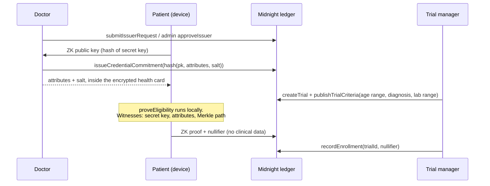
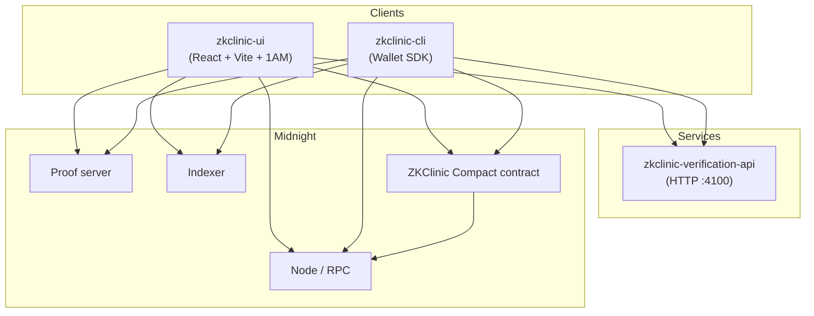

# ZKLinic

[](https://github.com/fahmmin/zklinic/actions/workflows/ci.yml)
[](LICENSE)

**Prove you qualify for a clinical trial without showing anyone your medical record.** Built on [Midnight](https://midnight.network).

Most clinical trials miss their recruitment targets. Eligible patients exist, but finding them means asking people to hand a full medical chart to a sponsor they have never met. ZKLinic removes that step: a licensed doctor attests a patient's health facts once, and the patient then proves "I meet this trial's criteria" in zero knowledge. The recruiter learns that an anonymous applicant is eligible. Nothing else.

ZKLinic is not a diagnostic app or a records platform. It is the trust layer between a patient's chart and a recruiter's eligibility question.

---

## What the chain sees, and what it never sees

| Stays on the patient's device (private state / witnesses) | Public on the Midnight ledger |
| --- | --- |
| ZK secret key | Approved doctors (issuer registry) |
| Age, diagnosis codes, lab values, credential expiry | A Merkle tree of credential **commitments** (hashes only) |
| Which commitment in the tree is theirs | Each trial's machine-checkable criteria |
| Which other trials they applied to | One **nullifier** per (patient, trial): the applicant's pseudonym |
| | Slot counts and enrollment of pseudonyms |

Three properties follow, and each is enforced by the contract and covered by tests:

- **Anonymous among all patients.** The proof shows membership in the commitment tree without revealing which leaf, so not even the issuing doctor can tell which patient applied.
- **Unlinkable across trials.** The nullifier is `hash(trialId, secretKey)`. The same patient gets an unrelated pseudonym in every trial.
- **No fake or replayed enrollments.** `recordEnrollment` only accepts a pseudonym that proved eligibility for that exact trial, once.

## How it works



The `proveEligibility` circuit ([contract/src/zkclinic.compact](contract/src/zkclinic.compact)) asserts, entirely inside the proof:

1. the patient knows a secret key and attributes whose commitment is in the doctor-attested Merkle tree,
2. the credential is not expired,
3. age is within the trial range,
4. the required diagnosis is present and the excluded diagnosis is absent,
5. the required lab value is within range,
6. this patient has not already proven for this trial.

## Midnight integration

| Piece | Where | Notes |
| --- | --- | --- |
| Compact contract | [contract/src/zkclinic.compact](contract/src/zkclinic.compact) | 13 provable circuits, 3 pure circuits, language 0.28, compiler 0.36.1 (ledger v9) |
| Witnesses and private state | [contract/src/witnesses.ts](contract/src/witnesses.ts) | 4 witnesses: `patientSecretKey`, `healthAttributes`, `credentialPath`, `recordApplication` (updates private state) |
| App data to circuit structs | [contract/src/eligibility.ts](contract/src/eligibility.ts) | One mapping shared by doctor, patient and manager, so the bytes compared in-circuit agree |
| Simulator and tests | [contract/src/test](contract/src/test) | Runs the compiled contract, one private state per actor |
| Web UI | [zkclinic-ui](zkclinic-ui) | React + Vite, 1AM / DApp Connector, proofs generated in the browser session |
| CLI | [zkclinic-cli](zkclinic-cli) | Headless Wallet SDK flows for every role, plus deploy |
| Verification API | [zkclinic-verification-api](zkclinic-verification-api) | Doctor licence checks, request and encrypted-card relay, human-readable trial metadata. Never sees the ZK secret key |

Dual-ledger use in one sentence: public state holds the registry, commitments, criteria and nullifiers; private state holds the secret key, the attested attributes and the patient's own application history, and only the witnesses read it.

## Try it in one minute (no wallet)

Open `/demo` in the web UI (`npm run dev -w zkclinic-ui`, then the "Try the 1-minute demo" button). Three taps take a patient from health card to enrolled, and a second patient shows a rejection. The buttons run the real compiled contract circuits inside the page through the simulator; a side panel shows what stays on the phone and what the study can see. It is built phone-first: large type, one action per screen, the button pinned at the bottom.

## Test it in two minutes (no network, no wallet)

```bash
npm ci
```

```bash
npm test
```

70 tests across four packages. The contract suite (40 tests) executes the **compiled contract's real circuit logic** through a simulator, not a mock:

- every eligibility rule, including inclusive boundaries and skipped optional rules
- expired credential, stale timestamp, closed trial, trial without criteria
- credential no doctor attested, attributes edited after attestation, a stolen Merkle path
- double proof for one trial, replay of a proof into another trial, over-enrollment
- a privacy test that dumps the entire public state and asserts it contains no secret key, patient public key, salt, or unrelated diagnosis

To recompile the contract yourself (Linux, macOS or WSL):

```bash
npm run compact -w contract
```

CI compiles the contract, typechecks and runs all tests on every push: [.github/workflows/ci.yml](.github/workflows/ci.yml).

## What changed in Wave 3

Wave 2 shipped the registries and the product flow, but eligibility was computed off-chain and reported to an API. The contract had no witnesses and no private state. Wave 3 makes the core claim real:

- **New private-state circuit `proveEligibility`** with four witnesses, a `HistoricMerkleTree` of credential commitments and per-trial nullifiers.
- **New circuits `issueCredentialCommitment` and `publishTrialCriteria`**; criteria are immutable once published.
- **`recordEnrollment` is now proof-bound.** In Wave 2 a manager could bump the slot counter freely.
- **Tests now run the compiled contract.** The Wave 2 contract tests exercised a hand-written TypeScript model; those are deleted.
- **UI**: the doctor attests age and labs, the patient's "Create proof" is an actual Midnight transaction, and the manager sees "Verified on Midnight" per applicant and can enroll only verified pseudonyms.
- **CLI**: doctor attest, patient prove, manager publish-criteria and proof-bound enroll.
- **Guided demo and phone layout**: `/demo` walkthrough; patient, doctor and study-manager screens rebuilt as three-step flows with prefilled values; bottom tab bar, larger type and tap targets, optional fields collapsed.
- **Ported to Midnight's ledger v9 hard fork**: compiler 0.36.1, compact-runtime 0.21 (async circuits), midnight-js 5.0 and wallet-sdk 2.0. The browser deploys and calls through the official DApp-connector providers, so 1AM proves, pays DUST and submits; no local proof server is needed for the web app. Deployed from the browser at `/deploy`.
- **Wallet sign-in and one role per person**: the 1AM wallet is the account (one tap, auto-reconnect with retry, real sign-out). Each wallet picks patient or study team once; a wallet approved as a doctor on-chain always opens on the doctor screen. Role switching is hidden behind a demo mode (`?demo=1` or long-press the logo).
- **Doctor identity check with Didit (optional)**: an ID + selfie check by [Didit](https://didit.me) during doctor sign-up. The verification API keeps only the outcome and `sha256(session, doctorKey)`, never ID data. Sandbox and offline mock modes for demos.
- **Repo hygiene**: Apache-2.0 licence, CI, cross-platform asset copy, removed 49 stale compiled `.js` files that shadowed the TypeScript sources.

## Known limits and roadmap

Stated plainly so nobody has to discover them:

- The circuit enforces one required diagnosis, one excluded diagnosis and one lab rule per trial, and a credential carries up to 4 diagnoses and 4 labs. Extra rules stay in the off-chain criteria document bound by `criteriaHash`.
- Revoking an anonymous commitment is not supported yet. `revokeCredential` still revokes the encrypted card by id, but the ZK circuit relies on expiry (12 months). Next step: an accumulator-based non-revocation proof.
- The patient's ZK key lives in browser storage. Clearing site data orphans attested cards until backup includes the key.
- The verification API relays patient intake in plaintext while a request is pending, and the card encryption key is derived from the request code it also relays. It is a convenience relay, not part of the privacy guarantee; production should encrypt the card to a patient-held key.
- Addresses below marked Wave 2 run the old contract on the pre-fork ledger; use the Wave 3 address.

Next: non-revocation proofs, multi-rule criteria, a sponsor-funded enrollment escrow, and a pilot with one clinic and one recruiting site.

## Who it is for

Patient recruitment is the largest single cost and delay in clinical development. The buyer is the trial sponsor or CRO, who pays per verified eligible applicant; the patient and the doctor pay nothing. ZKLinic gives sponsors pre-verified candidates without taking on the liability of holding raw health data, which is the part that makes hospitals and regulators say no today.

---

## Deployed contract addresses

| Network | Contract | Address (hex) |
| --- | --- | --- |
| Preview | Wave 2 (legacy) | `86b8c4ed80a2d6c4bc45a1ac134607afb1d1499e2a864a2f0241a2e1537a507e` |
| Pre-production | Wave 2 (legacy) | `f4bf7e879850040a0521234ea05824943cd60d32b669d8cba142a823cb6e3aae` |
| Pre-production | **Wave 3** (ledger v9) | `76099957e2d62de2587a4c0c7b6797715be6c5f9d03590a5443e39f27e2dfb55` |

The Wave 3 UI and CLI need a Wave 3 contract: the circuit set changed, so they cannot drive the legacy addresses.

---

## Point all clients at one Verification API base URL

Every component that talks to the HTTP API must use the **same origin** (scheme + host + port). For the hosted preprod demo, point everything at **https://zklinic-verification-api.onrender.com** (Render service name spelling). For local development, use `http://localhost:4100` (or your own hosted URL).


**CORS:** For browser access, set `ZKCLINIC_CORS_ORIGINS` on the verification API to include your UI origin (for example `http://localhost:5173` and your Vercel preview or production origin).

Copy-paste template for **preprod + hosted API** (adjust origin if you run the API yourself):

```bash
# zkclinic-cli — repo or package .env, or export before running
VERIFICATION_API_URL=https://zklinic-verification-api.onrender.com

# zkclinic-ui — e.g. .env.preprod / .env.local (Vite exposes only VITE_*)
VITE_VERIFICATION_API_URL=https://zklinic-verification-api.onrender.com

# zkclinic-verification-api — local dev only (default 4100)
PORT=4100
```

---

## Wallets


| Surface                    | Wallet                                                                                                                                                                                                 |
| -------------------------- | ------------------------------------------------------------------------------------------------------------------------------------------------------------------------------------------------------ |
| **Web UI (`zkclinic-ui`)** | **[1AM](https://1am.xyz/)** — Midnight browser wallet and DApp Connector; pick **Preview** or **Preprod** in the extension so it matches `VITE_NETWORK_ID`. The UI uses `@midnight-ntwrk/dapp-connector-api`, so other Midnight-ready wallets may work if they expose the same connector. |
| **CLI (`zkclinic-cli`)**   | **Midnight Wallet SDK** (headless HD wallet from mnemonic or generated seed) — same transaction and proof stack as production templates, without a browser extension.                                  |


Fund testnet addresses from the official faucets when using public networks:

- Preview: [https://faucet.preview.midnight.network](https://faucet.preview.midnight.network)  
- Pre-production: [https://faucet.preprod.midnight.network](https://faucet.preprod.midnight.network)

---

## Quick start

**Prerequisites:** Node.js **22** (see `.nvmrc`; the verification API server does not start on Node 24), npm **10+**, the `compact` compiler 0.36.1 on `PATH` (Linux, macOS or WSL), and a **proof server** at `http://127.0.0.1:6300` (or set `PROOF_SERVER_URL`) when the network expects local proving.

```bash
nvm use 22   # or equivalent
npm install
npm run compact -w contract
npm run build
```

**1. Verification API** (terminal 1):

```bash
npm run dev -w zkclinic-verification-api
```

**2. Proof server** (Preview example):

```bash
docker run -p 6300:6300 midnightntwrk/proof-server:7.0.0 -- midnight-proof-server -v
```

**3. Web UI** (terminal 2):

```bash
npm run dev -w zkclinic-ui
```

Open the app, install **[1AM](https://1am.xyz/)**, switch the extension to **Preview** or **Pre-production** to match your `.env` / Vite mode, then connect and join the contract address for that network (see table above).

**4. CLI** (optional third terminal) — Preview:

```bash
npm run cli:preview
# equivalent: npm run preview -w zkclinic-cli
```

Pre-production:

```bash
npm run cli:preprod
# equivalent: npm run preprod -w zkclinic-cli
```

Set `VERIFICATION_API_URL` in the environment (or `zkclinic-cli` / repo `.env`) so the CLI reaches the same API as the UI.

---

## Using the CLI

The CLI is an interactive menu driver: wallet → contract → role workflows. Most prompts accept **Enter** for sensible demo defaults when you are exploring locally.

**Scripts** (`zkclinic-cli/package.json`):


| Script               | Network                                                                                           |
| -------------------- | ------------------------------------------------------------------------------------------------- |
| `npm run preview`    | Midnight **Preview** (indexer v3 URLs in `PreviewConfig`)                                         |
| `npm run preprod`    | Midnight **Pre-production** (indexer **v4**; see `PreprodConfig` in `zkclinic-cli/src/config.ts`) |
| `npm run standalone` | Local undeployed stack (ports `9944` / `8088` / `6300`)                                           |


**Typical session shape** (matches a real Preview run; see `cli-logs.txt` in the repo for a full transcript):

1. **Wallet** — Generate, import mnemonic, or use `WALLET_MNEMONIC` / `WALLET_MNEMONIC_DOCTOR` / `WALLET_MNEMONIC_ADMIN` / `WALLET_MNEMONIC_TRIAL` / `WALLET_MNEMONIC_PATIENT` from `.env`. Wait until sync completes; fund from the faucet if balances are zero.
2. **Contract** — Deploy new, or **join existing** by pasting the 64-hex address (Enter defaults to `ZKCLINIC_CONTRACT_ADDRESS` if set).
3. **Role menu**
  - **Doctor** — Issuer request, unified API + on-chain registration, fulfill patient request by **request code**, register or revoke credentials on-chain, **attest ZK credential** (commitment on-chain, attributes JSON for the patient).
  - **Patient** — Create **credential request**, **show ZK public key**, **prove eligibility for a trial** (prints the nullifier = proof ID).
  - **Admin** — Approve or revoke issuers, transfer admin.
  - **Trial manager** — Create trial and publish on-chain criteria, enroll a proof ID, close trials.
  - **Utilities** — Random license hash, demo copy-paste sheet, **switch contract**, **view on-chain state** (indexer snapshot for the joined registry).

Example excerpt: after joining, **Utilities → View on-chain state** prints issuers, credentials, diagnosis commitment rows, and trials for that contract. **Doctor → Fulfill patient request** consumes the patient’s code, appends diagnosis commitments, registers the credential on-chain, and returns ciphertext the patient can decrypt with their code.

---

## System architecture




| Package                                                    | Role                                                                                                                               |
| ---------------------------------------------------------- | ---------------------------------------------------------------------------------------------------------------------------------- |
| `[contract/](contract/)`                                   | Compact sources → `managed/zkclinic`, TypeScript bindings (`zkclinic-contract`).                                                   |
| `[zkclinic-cli/](zkclinic-cli/)`                           | Headless **Preview**, **Pre-production**, and **standalone** flows.                                                                |
| `[zkclinic-ui/](zkclinic-ui/)`                             | Patient, doctor, admin, and trial-manager UX; copies ZK artifacts to `public/zkclinic` at build.                                   |
| `[zkclinic-verification-api/](zkclinic-verification-api/)` | Issuer attestation and verification, credential request lifecycle, trial metadata and validation endpoints consumed by UI and CLI. |


**On-chain (Compact)** — `contract/src/zkclinic.compact`: issuer registry, credential registration and revocation, credential commitments (`issueCredentialCommitment`), trial lifecycle (`createTrial`, `publishTrialCriteria`, `closeTrial`), private eligibility (`proveEligibility`), proof-bound enrollment (`recordEnrollment`), and admin transfer.

---

## User flow (end-to-end)

```mermaid
sequenceDiagram
  participant P as Patient
  participant API as Verification API
  participant D as Doctor
  participant A as Admin
  participant L as Midnight ledger

  D->>L: submitIssuerRequest (license commitment)
  D->>API: Registration / attestation path
  A->>API: Attestation + review where required
  A->>L: approveIssuer (with attestation binding)

  P->>API: Create credential request
  API-->>P: Short request code
  P->>D: Share code (out of band)
  D->>API: Resolve request, attach clinical payload
  D->>L: registerCredential + diagnosis commitments
  D->>L: issueCredentialCommitment (ZK attestation)
  D->>API: Deliver encrypted credential bundle
  P->>API: Fetch ciphertext, decrypt locally

  Note over P,L: Trials — manager publishes criteria on-chain. Patient proves eligibility in zero knowledge; only a per-trial nullifier is public.
```


**Milestone-style flow:**

1. **Issuer trust** — Doctor requests inclusion; admin approves with attestation data anchored on-chain.
2. **Credentials** — Patient gets a request code; doctor fulfills and registers on-chain; patient holds encrypted material locally.
3. **Trials** — Manager creates trials and publishes machine-checkable criteria; patients prove eligibility with `proveEligibility`; enrollment is only possible for a proven pseudonym and capacity is enforced on-chain.

**Preprod quick alignment:** Join your Wave 3 contract address (table above), set `VITE_VERIFICATION_API_URL` / `VERIFICATION_API_URL` to `https://zklinic-verification-api.onrender.com`, use **[1AM](https://1am.xyz/)** on preprod in the browser, and keep a local **proof server** reachable at `PROOF_SERVER_URL` (for example `http://127.0.0.1:6300`) so wallet/SDK “dust” sync can finish — without it, CLI sync may sit on `dust=false` until timeout.

---

## Repository layout and scripts

Root `[package.json](package.json)` workspaces:

- `npm run build` — contract + CLI + UI + verification API  
- `npm run test` / `npm run typecheck` — aggregate across packages  
- `npm run cli:preview` / `npm run cli:preprod` / `npm run cli:standalone` — convenience CLI entrypoints

**UI build modes:** see `zkclinic-ui` scripts (`dev`, `dev:undeployed`, `build:preview`, etc.) and Vite env files (`.env.preview`, `.env.undeployed`).

**Playwright E2E** (UI):

```bash
npm run test:e2e:install -w zkclinic-ui
npm run test:e2e
```

---

## Additional configuration (optional)

- **CLI contract default:** set `ZKCLINIC_CONTRACT_ADDRESS` (64 hex) so “join existing” can press Enter.  
- **UI contract pre-fill:** `VITE_CONTRACT_ADDRESS`; optional `VITE_AUTO_JOIN_CONTRACT=true` for a single automatic join attempt.  
- **Admin-only UI actions:** align `VITE_ZKCLINIC_ADMIN_TOKEN` with `ZKCLINIC_ADMIN_TOKEN` on the verification API where those endpoints are used.  
- **Persistence:** verification API stores state under `data/` by default; override with `ZKCLINIC_PERSISTENCE_PATH` if needed.
- **Didit identity check for doctors (optional):** set `DIDIT_API_KEY` and `DIDIT_WORKFLOW_ID` on the verification API. With a sandbox-mode Didit application, also set `DIDIT_SANDBOX_SCENARIO=approve` for free, simulated sessions. `DIDIT_MOCK=1` runs the same flow offline and always approves. ZKLinic stores only the result and a hash of (session, doctor key), never ID data.

---

## Resources


| Resource                                 | URL                                                                                                                                  |
| ---------------------------------------- | ------------------------------------------------------------------------------------------------------------------------------------ |
| ZKClinic Verification API (preprod demo) | [https://zklinic-verification-api.onrender.com](https://zklinic-verification-api.onrender.com)                                       |
| Midnight docs                            | [https://docs.midnight.network](https://docs.midnight.network)                                                                       |
| Compact language reference               | [https://docs.midnight.network/develop/reference/compact/lang-ref](https://docs.midnight.network/develop/reference/compact/lang-ref) |
| 1AM wallet (Midnight)                    | [https://1am.xyz/](https://1am.xyz/)                                                                                                |
| Lace wallet (alternative connector)    | [https://www.lace.io](https://www.lace.io)                                                                                          |
| Preview faucet                           | [https://faucet.preview.midnight.network](https://faucet.preview.midnight.network)                                                   |
| Pre-production faucet                    | [https://faucet.preprod.midnight.network](https://faucet.preprod.midnight.network)                                                   |

---

## License

[Apache License 2.0](LICENSE). Built for the Midnight Buildathon; uses the Midnight SDKs and Compact toolchain by the Midnight Foundation and Shielded Technologies.
